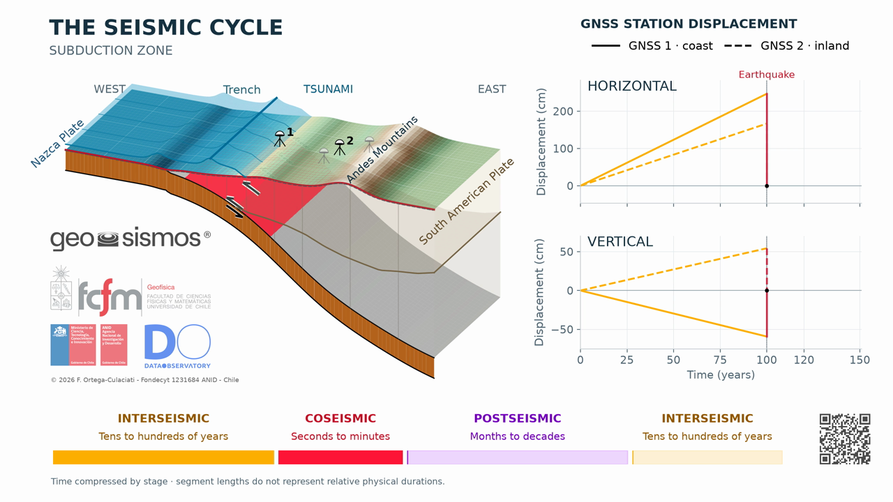

# Seismic Cycle

## English

An animation depicting the seismic cycle at a subduction zone (Nazca Plate converging beneath the South American Plate, Central Chile), combining a map/cross-section view, GNSS station displacement time series, tsunami generation, and seismic wave (P/S) propagation. It illustrates the cycle's three phases: the **interseismic** period of locked-interface strain accumulation (decades–centuries), the **coseismic** earthquake rupture (seconds–minutes), and the **postseismic** afterslip relaxation (months–decades).

The animation is available in six versions (MP4):

- ⬇️ [Long, with GNSS (1 min 35 s)](https://raw.githubusercontent.com/frortega/Seismic-Cycle-Animations/main/Seismic-Cycle/ANIMATIONS/English/SeismicCycle_long_GNSS_english.mp4): complete version, from the Earth and the map of Chile to the 3-D subduction model, with an explanation of each stage, GNSS time series and closing credits.
- ⬇️ [Long fast, with GNSS (1 min)](https://raw.githubusercontent.com/frortega/Seismic-Cycle-Animations/main/Seismic-Cycle/ANIMATIONS/English/SeismicCycle_long_fast_GNSS_english.mp4): the complete version condensed to under one minute.
- ⬇️ [Long, without GNSS (1 min 35 s)](https://raw.githubusercontent.com/frortega/Seismic-Cycle-Animations/main/Seismic-Cycle/ANIMATIONS/English/SeismicCycle_long_english.mp4): complete version focused on the 3-D model, without GNSS stations or time series (nearly square frame).
- ⬇️ [Long fast, without GNSS (1 min)](https://raw.githubusercontent.com/frortega/Seismic-Cycle-Animations/main/Seismic-Cycle/ANIMATIONS/English/SeismicCycle_long_fast_english.mp4): the version without GNSS condensed to under one minute.
- ⬇️ [Short, with GNSS (30 s)](https://raw.githubusercontent.com/frortega/Seismic-Cycle-Animations/main/Seismic-Cycle/ANIMATIONS/English/SeismicCycle_short_GNSS_english.mp4): one seismic cycle on the 3-D model with GNSS time series and a one-line summary of each stage under the time bar; no introduction or credits.
- ⬇️ [Short, without GNSS (30 s)](https://raw.githubusercontent.com/frortega/Seismic-Cycle-Animations/main/Seismic-Cycle/ANIMATIONS/English/SeismicCycle_short_english.mp4): one seismic cycle on the 3-D model only, with a one-line summary of each stage (nearly square frame).

All versions show the project logos, the copyright and a QR code linking to this repository. Videos are H.264 MP4 at 24 fps: 2560×1440 with GNSS, 1452×1344 (long) and 1526×1440 (short) without GNSS.

## Español

Una animación que muestra el ciclo sísmico en una zona de subducción (convergencia de la Placa de Nazca bajo la Placa Sudamericana, Chile Central), combinando una vista de mapa/perfil, series de tiempo de desplazamiento de estaciones GNSS, generación de tsunami y propagación de ondas sísmicas (P/S). Ilustra las tres etapas del ciclo: el período **intersísmico** de acumulación de deformación por bloqueo de la interfaz (décadas-siglos), la ruptura **cosísmica** del terremoto (segundos-minutos), y la relajación **postsísmica** por deslizamiento lento (meses-décadas).

La animación está disponible en seis versiones (MP4):

- ⬇️ [Larga, con GNSS (1 min 35 s)](https://raw.githubusercontent.com/frortega/Seismic-Cycle-Animations/main/Seismic-Cycle/ANIMATIONS/Espanol/CicloSismico_long_GNSS_espa%C3%B1ol.mp4): versión completa, desde la Tierra y el mapa de Chile hasta el modelo 3-D de subducción, con la explicación de cada etapa, series de tiempo GNSS y créditos finales.
- ⬇️ [Larga rápida, con GNSS (1 min)](https://raw.githubusercontent.com/frortega/Seismic-Cycle-Animations/main/Seismic-Cycle/ANIMATIONS/Espanol/CicloSismico_long_fast_GNSS_espa%C3%B1ol.mp4): la versión completa condensada en menos de un minuto.
- ⬇️ [Larga, sin GNSS (1 min 35 s)](https://raw.githubusercontent.com/frortega/Seismic-Cycle-Animations/main/Seismic-Cycle/ANIMATIONS/Espanol/CicloSismico_long_espa%C3%B1ol.mp4): versión completa centrada en el modelo 3-D, sin estaciones ni series de tiempo GNSS (cuadro casi cuadrado).
- ⬇️ [Larga rápida, sin GNSS (1 min)](https://raw.githubusercontent.com/frortega/Seismic-Cycle-Animations/main/Seismic-Cycle/ANIMATIONS/Espanol/CicloSismico_long_fast_espa%C3%B1ol.mp4): la versión sin GNSS condensada en menos de un minuto.
- ⬇️ [Corta, con GNSS (30 s)](https://raw.githubusercontent.com/frortega/Seismic-Cycle-Animations/main/Seismic-Cycle/ANIMATIONS/Espanol/CicloSismico_short_GNSS_espa%C3%B1ol.mp4): un ciclo sísmico en el modelo 3-D con series de tiempo GNSS y un resumen de una línea de cada etapa bajo la barra de tiempo; sin introducción ni créditos.
- ⬇️ [Corta, sin GNSS (30 s)](https://raw.githubusercontent.com/frortega/Seismic-Cycle-Animations/main/Seismic-Cycle/ANIMATIONS/Espanol/CicloSismico_short_espa%C3%B1ol.mp4): un ciclo sísmico solo en el modelo 3-D, con un resumen de una línea de cada etapa (cuadro casi cuadrado).

Todas las versiones muestran los logos del proyecto, el copyright y un código QR que enlaza a este repositorio. Los videos son MP4 (H.264) a 24 cuadros por segundo: 2560×1440 con GNSS; 1452×1344 (larga) y 1526×1440 (corta) sin GNSS.

## Credits

- **© 2026 F. Ortega-Culaciati, J. Ruiz Paredes**
- QUEST, Project Fondecyt 1231684, ANID, Chile
- Department of Geophysics, FCFM, Universidad de Chile, Santiago, Chile
- Data Observatory Foundation, ANID Technology Center No. DO210001, Santiago, Chile

## Acknowledgements
**Funded by Project Fondecyt 1231684 - ANID - Chile.**

## License

This work is licensed under the [Creative Commons Attribution 4.0 International License (CC BY 4.0)](https://creativecommons.org/licenses/by/4.0/). You are free to share and adapt the material for any purpose, even commercially, as long as you give appropriate credit. See full license for the contents of this repository in the file [LICENSE.txt](../LICENSE.txt).

## Built with

- [Python](https://www.python.org/) - [NumPy](https://numpy.org/) - [Matplotlib](https://matplotlib.org/) - [Pillow](https://python-pillow.org/) - [SciPy](https://scipy.org/) - [netCDF4](https://unidata.github.io/netcdf4-python/) - [pyproj](https://pyproj4.github.io/pyproj/) - [tqdm](https://github.com/tqdm/tqdm) - [FFmpeg](https://ffmpeg.org/) - [GNU Fortran (gfortran)](https://gcc.gnu.org/fortran/).

## : GNSS observations of Earth's Crustal Deformation
To explore and download positional time series of GNSS observations in Chile, as the ones
depicted in the animations, please go to the GeoSismos platform by clicking [HERE](https://geosismos.cl/)
